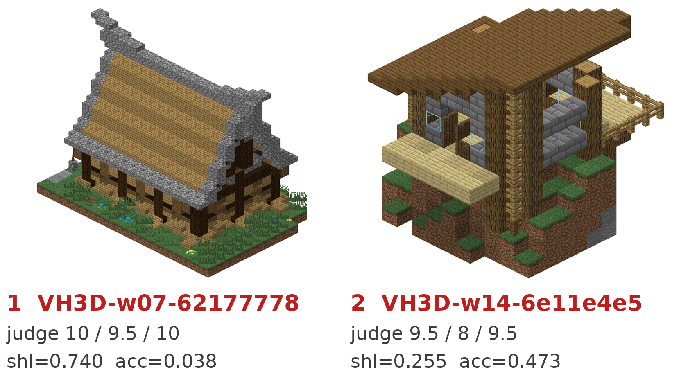
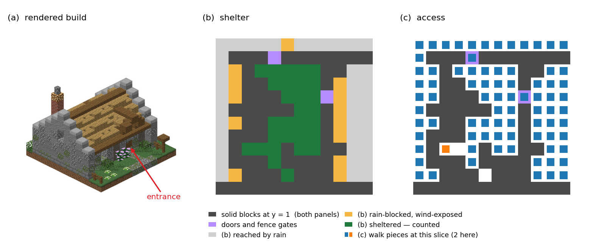

<h1 align="center">Shelter and Access: One-Sided, Falsifiable Interior Measures for Generated Voxel Buildings</h1>

<p align="center">Jen-Kai Lin</p>
<p align="center"><em>NeurIPS 2026 Workshop on Embodied Spatial Reasoning (ESR), paper track</em></p>

<div align="center">

[](paper/shelter_and_access_esr2026.pdf)
[](https://openreview.net/forum?id=qz1PLOrNPZ)
[](https://huggingface.co/datasets/jenkai-lin/VoxHouse3D)
[](LICENSE)

</div>

<p align="center"></p>

## TL;DR

Evaluation of open-ended building generation (procedural generators, diffusion models, LLM agents) rests on human ratings, visual models or similarity to a reference. None of them answers: **can an agent with a body use this structure as a house?**

`structgauge` answers that with two **one-sided** measures computed from voxel geometry alone:

| measure | question | one-sided claim |
|---|---|---|
| **shelter** | can the building provide cover? | **low &rArr; not sheltered**<br>(high is *not* a quality claim) |
| **access** | can a player-sized body walk from outdoor to indoor space? | **low &rArr; not enterable**<br>(high is *not* a quality claim) |


Both are defined on the **interior field Ω**, which measures how enclosed each air cell is: a discounted multi-bounce field with an exact sparse linear-system solution (no sampling, no learning, no parameter fitted to labels). A low score means the building fails a necessary condition of a usable house (no cover, or no way in), a fact checkable in its geometry. The paper also introduces **VoxHouse3D**, a dataset of 2,007 player-built houses and 2,023 same-provenance non-house structures, taken from 28 archived worlds of real community servers, one map file each.

<p align="center"></p>

## Results

Discrimination of house vs. non-house on VoxHouse3D (AUC, same 4,030 builds):

| measure | AUC |
|---|---|
| shelter | 0.8681 |
| access | 0.8424 |
| size-only baseline (solid fraction, `solid_fraction`) | 0.6550 |
| size-only baseline (log block count, `log_block_count`) | 0.6275 |

Both measures are one-sided: AUC is reported for discrimination, not as a ranking score. The dataset release recomputes this table from the shipped per-build readings in under a minute (`reproduce/reproduce.py`, standard library only).

## What is in this repository

| path | what |
|---|---|
| `structgauge/` | the measure implementation |
| `paper/` | the accepted paper (PDF) |
| `assets/` | figures used on this page |
| `CITATION.cff` | how to cite |

The dataset (4,030 builds: geometry, labels, per-build readings; CC BY-NC 4.0) and the scripts that recompute the paper's table live on Hugging Face: https://huggingface.co/datasets/jenkai-lin/VoxHouse3D

## Quick start

```bash
# 1. Install (Python >= 3.9; pulls numpy and scipy >= 1.12)
pip install git+https://github.com/KyleLin0927/structgauge.git

# 2. Measure one build (any .npz in the VoxHouse3D release format, or your own array)
structgauge measure VH3D-w03-a78fe8df.npz

# 3. Run the paper's protocol on a folder of builds
structgauge bench my_generator_outputs/ --label my_generator
```

## Usage

```python
import structgauge as sg

build = sg.load("VH3D-w03-a78fe8df.npz")   # release format
# build = sg.from_array(ids)               # or your own int array, indexed [x, y, z], y up

m = sg.measure(build)
m.shelter, m.access                        # e.g. 0.6526, 0.7641
```

| command | what it prints |
|---|---|
| `structgauge measure BUILD.npz [...]` | both readings per build (`--json` for machine-readable output) |
| `structgauge constants` | the constants in effect (discount &gamma;, block semantics, frozen thresholds, block-table version); the defaults reproduce the paper |
| `structgauge bench FOLDER/` | alarm rates of every `.npz` in the folder against the frozen thresholds |

`bench` runs the protocol behind Table 3 of the paper. Point it at a folder of `.npz` builds from one generator; for every build it computes both measures, then reports the **share of builds below the frozen thresholds** (the human-house 10th percentile: shelter 0.3748, access 0.4526) as a new row next to the reference rows from the paper (human houses, other structures, and the generators we evaluated).

| argument | meaning | default |
|---|---|---|
| `FOLDER/` | folder of `.npz` builds (release format) | required |
| `--label NAME` | name of your row in the table | folder name |
| `--B N` | bootstrap resamples for the 95% CI | 2000 |
| `--json` | print the result as JSON instead of a table | off |
| `--thr-shelter X`, `--thr-access X` | override the frozen thresholds; **sensitivity checks only**, the reference rows are then no longer comparable and the output says so | frozen |

What `bench` prints:

```
structgauge bench | one-sided alarm rates (frozen human-house 10th-percentile thresholds: shelter 0.3748 / access 0.4526; a rate is the share of builds below the threshold, not a severity)
┌─────────────────────────────────────────────────┬──────┬─────────────────────────┬─────────────────────────┬─────────────────────────┐
│ source                                          │    n │ shelter alarm [95% CI]  │ access alarm [95% CI]   │ either [95% CI]         │
├─────────────────────────────────────────────────┼──────┼─────────────────────────┼─────────────────────────┼─────────────────────────┤
│ * my_generator                                  │   20 │ 0.2500 [0.0500, 0.4500] │ 0.5500 [0.3500, 0.7500] │ 0.6000 [0.4000, 0.8000] │
│ Human house (reference)                         │ 2007 │ 0.1001                  │ 0.1001                  │ 0.1809                  │
│ Same-provenance non-house                       │ 2023 │ 0.7039                  │ 0.6555                  │ 0.8794                  │
│ Creative Agents (image-to-voxel reconstruction) │ 1000 │ 0.9050                  │ 0.6690                  │ 0.9440                  │
│ Build-with-Bombs (voxel diffusion)              │ 2000 │ 0.8865                  │ 0.2050                  │ 0.9220                  │
│ MSG (autoregressive completion)                 │  300 │ 0.8600                  │ 0.4733                  │ 0.9233                  │
│ Direct LLM (pooled)                             │  178 │ 0.2697                  │ 0.5337                  │ 0.7360                  │
└─────────────────────────────────────────────────┴──────┴─────────────────────────┴─────────────────────────┴─────────────────────────┘
frozen: line=(0.37476, 0.45256) = human-house 10th percentile; gamma=0.9; block semantics=v2 (official collision boxes); reference=VoxHouse3D v1.1 (2,007 house / 2,023 other_structure)
```

The thresholds, &gamma; and the block semantics are frozen in `structgauge/report/bench_reference.json`, so your row is directly comparable with the paper's.

## Takedown and contact

The dataset rests on the work of anonymous community builders. If you are a builder and want a structure removed, open a **[takedown issue](https://github.com/KyleLin0927/structgauge/issues/new?template=takedown.md)** (template provided) or write to kylelin0927@gmail.com; removal ships with the next dataset release.

## Acknowledgements

We owe our deepest thanks to the anonymous community builders whose works constitute the dataset, and to the BlockBox community and the UNSW Minecraft Society for archiving their worlds under Creative Commons licences. We also thank the authors of the open generators evaluated in the paper for releasing their systems.

## Citation

```bibtex
@inproceedings{structgauge_2026,
  title     = {Shelter and Access: One-Sided, Falsifiable Interior Measures for Generated Voxel Buildings},
  author    = {Lin, Jen-Kai},
  booktitle = {NeurIPS 2026 Workshop on Embodied Spatial Reasoning (ESR)},
  year      = {2026}
}
```

## License

Code: Apache-2.0 (see `LICENSE`, `NOTICE`). The dataset is licensed separately (CC BY-NC 4.0) and is not part of this repository.
